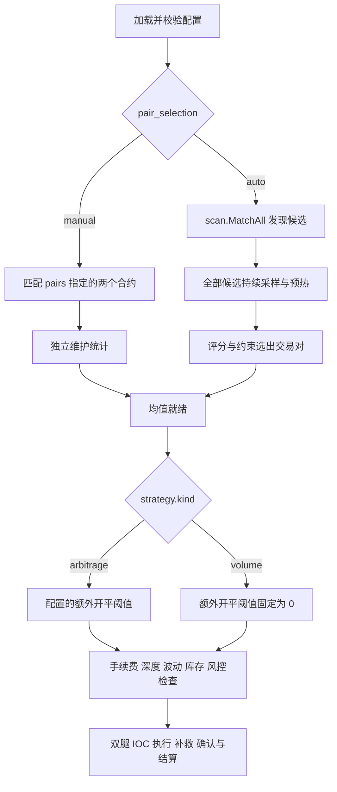

# 策略与选币完整链路

`strategy.kind` 决定交易条件，`strategy.pair_selection` 决定交易对来源。二者独立组合，选币方式不会把套利策略切换成刷量策略，也不会改变均值窗口。

| 组合 | 交易对来源 | 统计与决策 |
|---|---|---|
| arbitrage + manual | `pairs` 指定的 base、左右 venue、step_qty、max_steps | 对指定合约匹配、对齐精度，每对维护统计；预热后按配置的套利条件交易。 |
| volume + manual | 同上 | 使用同一统计与执行链路，额外开平阈值固定为 `0/0`，附加 volume 库存地板。 |
| arbitrage + auto | 扫描模块发现的匹配候选，经健康评分、白名单、TopY、dwell、额度及市场排他检查选出 | 候选持续采样和预热，晋升 actor 共享该统计，执行 arbitrage。 |
| volume + auto | 同上 | 共用自动选币流程，晋升 actor 执行 volume 的 `0/0` 阈值及库存地板规则。 |

## 从配置到成交



公共入口是 `engine.Run`；manual/auto 分别进入 `runManual/runAuto`，最终都调用 `runtime.buildActor` 和同一 `PairActor`、执行器、风控、账本及监控。

除流程图中的门槛外，策略的 Open 与 Close 都受 **σ 就绪准入闸**约束：σ 按增量计数就绪（攒满 `horizon/interval` 个增量即 ready，断链不作废），未就绪时仅救援、drain 与应急清仓可用。可选开启 `execution.adaptive_latency` 后，σ 窗口按实测腿延迟自适应，价差窗口取两腿较大者。

manual 只订阅配置对的合约，不会因为扫描发现了其他币而自行添加。auto 的候选由 `scan.MatchAll` 在启动时发现，与独立 `cmd/scanner` 共用匹配和左右腿顺序；`auto.candidates` 仅限制新交易的白名单。auto 不读取 scanner 的终端输出，也不要求额外启动 scanner 进程。

auto 的 picker 按 `scan.HealthTracker` 健康评分排序；独立 scanner 面板显示的是扣除费用与缓冲后的净机会，两者排序指标不同。候选被晋升只表示可以交给策略评估，不表示必须下单。成交仍需该时刻的策略、深度和风险条件全部满足。旧仓恢复先于新晋升；退出遵守 drain 与未决订单确认流程。

## 2 小时窗口与 1 小时预热

两种策略、两种选币方式均使用同一组配置和估计器工厂：

```yaml
estimator:
  kind: sma
  window: 2h
  min_warmup: 60m
  min_coverage: 0.8
  interval: 1s
```

窗口最多保留最近 7,200 个一秒桶。至少经过一小时采样历史、窗口样本覆盖率达到 80%，且最近样本新鲜，均值才就绪；时间桶跨度不能代替实际预热时长。运行满两小时后持续移除最老样本并加入新样本，保持滚动窗口，无须每两小时重新停机预热。整窗数据过期后重新开始采样，需要重新预热。

manual 由 actor 采样；auto 由候选收集器采样，actor 晋升后直接共享已预热的均值、价差波动及单腿波动，不会再等一小时。auto 的评分 dwell 和扫描周期可能使晋升晚于均值就绪时间。未预热时禁止新开仓；已恢复旧仓的减仓、未决订单确认和应急退出仍可运行。

## arbitrage 与 volume 的参数

设 `devLS=LS−μ`、`devSL=SL+μ`。额外开仓门槛之外，还要预留按当前价格计算的往返手续费与 `vol_k×σ`：

```text
开仓：对应方向 dev >= effective_open_bps + 预计往返手续费bps + vol_k × σ
平仓：实际入场基准下的预计净收益bps >= effective_close_bps
```

arbitrage 使用 `strategy.open_bps/close_bps`；volume 的注册实现自己固定这两项为零，避免换入口后丢失规则。`strategy.Parameters` 应用有效参数，`strategy.OpeningMargins` 为 scanner 和交易策略提供同一费用与波动门槛。

零额外门槛仍需覆盖手续费、满足盘口深度、持仓方向和步数约束，且 σ 必须就绪。`vol_k` 默认 1.28；显式配置 `0` 可关闭波动过滤（σ 仍须就绪，因让价依赖腿价 σ），均值预热仍必须完成。扫描器会保留实际波动是否就绪的状态，过滤关闭时无需等待无用的波动就绪。

volume 额外使用 `min_inventory` 库存地板。原 `daily_volume_target` / `daily_cost_budget` 每日预算已移除（量/盈亏记账仅作 state 审计痕迹）。这些设置不改变交易对来源和均值配置。旧 `loss_tolerance_bps` 字段仅保留零值兼容，active volume 配成非零会立即报错，不能把额外开仓门槛变成负数。未知 `strategy.kind` 也在加载时即报错，无须等 auto 晋升才发现。

scanner 使用配置的行情端点、链和盘口深度，移除交易凭证。多个 venue 组合即使 base 相同也各自保留，面板显示左右 venue，避免同名覆盖。

## 回归验证

- `engine.TestStrategySelectionMatrixWarmsTradesAndRetainsTwoHourWindow`：四种组合的有效参数、预热门控、模拟开平仓结算和两小时滚动淘汰。以虚拟时间喂入样本，不等待真实一小时。
- `engine.TestManualUsesConfiguredPairsAndAutoConsumesScannedUniverse`：manual 只订阅配置对；auto 的 `pairs` 即使指向未上市 base，仍订阅扫描模块发现的候选。
- `scan.TestMatchAllPreservesEveryVenueCombinationAndInstrument`：左右 venue、合约 ID、共同精度与所有组合一致。
- `scan.TestWatchUsesStrategyThresholdsAndOptionalVolatility`：扫描使用实际 strategy 类型和四笔手续费，关闭波动过滤时仍等待均值预热。
- `strategy.TestVolumeOwnsZeroThresholdsAndRetainsTradingGuards`、`TestOpeningMarginsAgreeWithBothStrategyThresholds`：零额外阈值不跳过费用、波动、深度或库存门控。
- `estimator.TestSMAWarmupRequiresElapsedTimeAndRestartsAfterEmptyWindow`、`backtest.TestReplayRequiresActualWarmupDuration`：时间桶边界不会使预热提前，整窗失效后重新预热。

全部验证仅使用单元测试、内存行情和模拟成交；没有启动项目、scanner 命令、服务或真实交易。

2026-10-16 的完整验证：全部测试包 `go test -race ./...`、`go vet ./...`、五个命令编译与格式检查通过（含 σ 计数就绪准入闸与自适应波动窗口的回归用例）。
